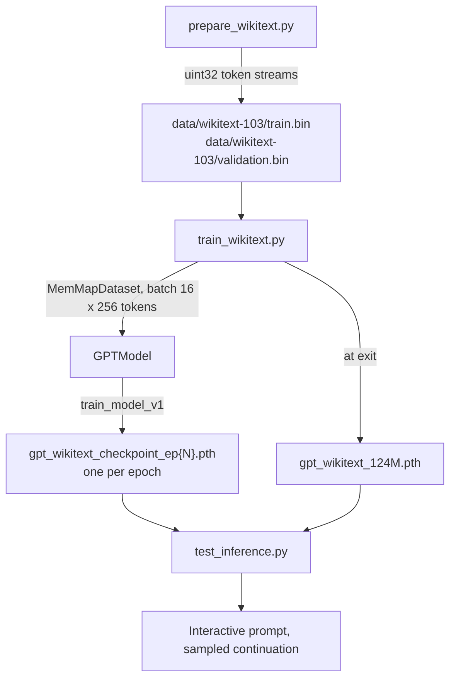

# mini-llm: codebase documentation

A GPT-style, decoder-only language model written from scratch in PyTorch. The repository has two layers:

- **Study scripts** (`src/p01_*` to `src/p04_*`): four stages that build the ideas up one at a time, from a regex tokenizer to a transformer block. Most of them print their results and are not imported by anything.
- **The model path** (`src/model.py`, `src/transformer.py`, `src/utils/`, and three root scripts): the pieces that are wired together to prepare WikiText-103, train on it, and sample from the result.

## Snapshot

These docs describe the code at commit `0bb727c` (2026-06-23) plus two files that are not tracked by git, `Colab_Training.ipynb` and `PROJECT_IMPLEMENTATION.md`. They were written on 2026-10-10.

Where a page says **verified**, the behaviour was checked by running the code on CPU with Python 3.10.20, torch 2.2.2, tiktoken 0.14.0 and numpy 1.26.4. The following were **not run**: `test.py`, `prepare_wikitext.py`, `train_wikitext.py` as a whole, the interactive loop in `test_inference.py`, the notebook, and anything on CUDA. Statements about those come from reading the code.

## Three things to know before reading the rest

1. **The causal mask is never applied.** `MultiHeadedAttention` builds the mask but discards the result of `masked_fill`, so every position attends to later positions, including the token it is being trained to predict. Verified. See [08-known-issues.md](08-known-issues.md#1-the-causal-mask-is-never-applied).
2. **The model has 239,365,632 parameters, not 124M.** The config keeps the name `GPT_CONFIG_124M`, but the vocabulary is twice GPT-2's and the output head is not tied to the token embedding. Verified. See [04-model.md](04-model.md#parameter-budget).
3. **Everything assumes the repo root is the working directory.** There are no `__init__.py` files and no dependency manifest; imports such as `from src.model import GPTModel` and paths such as `data/basic-data.txt` only resolve from the root. See [07-running.md](07-running.md).

## Pages

| Page | Covers |
|---|---|
| [01-tokenization.md](01-tokenization.md) | Regex tokenizer, `SimpleTokenizer` / `SimpleTokenizerV2`, the `cl100k_base` BPE tokenizer |
| [02-data-pipeline.md](02-data-pipeline.md) | Sliding-window datasets, embedding demos, WikiText-103 preparation, the memory-mapped dataset |
| [03-attention.md](03-attention.md) | The attention progression from dot products to `MultiHeadedAttention` |
| [04-model.md](04-model.md) | `LayerNorm`, `GELU`, `FeedForward`, `TransformerBlock`, `GPTModel`, the config, the parameter budget |
| [05-training.md](05-training.md) | Loss, evaluation, the training loop, `test.py`, `train_wikitext.py`, checkpoints, the Colab notebook |
| [06-inference.md](06-inference.md) | Greedy and sampled generation, the interactive CLI |
| [07-running.md](07-running.md) | Environment, the command for every script, and what each one writes to disk |
| [08-known-issues.md](08-known-issues.md) | Defects, gaps and duplicated code, each with its location and how it was checked |

## End-to-end flow



`test.py` is a smaller version of the same loop: it trains the same model on `data/basic-data.txt` on CPU using the in-memory `CustomDataset`.

## Repository map

```text
mini-llm/
├── README.md                  project overview and quick start
├── config.py                  GPT_CONFIG_124M, the one model config
├── device.py                  prints cuda/cpu; not imported by anything
├── prepare_wikitext.py        download + tokenize WikiText-103 into .bin files
├── train_wikitext.py          main training script (GPU, resume, torch.compile)
├── test.py                    smoke test + 10-epoch training on basic-data.txt (CPU)
├── test_inference.py          load weights, interactive generation
├── Colab_Training.ipynb       untracked; runs prepare + train on a Colab T4
├── PROJECT_IMPLEMENTATION.md  untracked; an earlier write-up (see known issues)
├── data/
│   └── basic-data.txt         20,480-character short story used by the study scripts
├── docs/                      this folder
├── graphify-out/              gitignored output of a code-graph tool
└── src/
    ├── model.py               GPTModel
    ├── transformer.py         TransformerBlock
    ├── p01_tokenization/      stage 1: tokenizers
    ├── p02_data_loading/      stage 2: sliding windows and embeddings
    ├── p03_attention/         stage 3: attention variants
    ├── p04_gpt/               stage 4: LayerNorm, GELU, FeedForward, sandbox
    └── utils/                 dataloaders, loss, evaluation, trainer, generation
```

## File reference

### Model path

These are the files the entry points import, directly or indirectly.

| File | Defines | Imported by |
|---|---|---|
| `config.py` | `GPT_CONFIG_124M` | `test.py`, `train_wikitext.py`, `test_inference.py` |
| `src/model.py` | `GPTModel` | the three scripts above |
| `src/transformer.py` | `TransformerBlock` | `src/model.py`, `src/p04_gpt/architecture.py` |
| `src/p03_attention/attention_modules.py` | `SelfAttention_v1`, `SelfAttention_v2`, `MultiHeadAttentionWrapper`, `MultiHeadedAttention` | `src/transformer.py` (only `MultiHeadedAttention`) |
| `src/p04_gpt/feedforward.py` | `LayerNorm`, `GELU`, `FeedForward` | `src/model.py`, `src/transformer.py` |
| `src/p04_gpt/textgen.py` | `textgen_v1` | `test.py`; `train_wikitext.py` imports it but never calls it |
| `src/utils/dataloader.py` | `CustomDataset`, `create_dataloader`, `MemMapDataset`, `create_memmap_dataloader` | `test.py`, `train_wikitext.py` |
| `src/utils/loss.py` | `calc_loss_batch`, `calc_loss_loader` | `src/utils/trainer.py`, `src/utils/evaluator.py`, `test.py` |
| `src/utils/evaluator.py` | `evaluate_model` | `src/utils/trainer.py` |
| `src/utils/text2token.py` | `textgen_v1`, `textgen_v2`, `text_to_token_ids`, `token_ids_to_text`, `generate_and_print_sample` | `src/utils/trainer.py`, `test.py` |
| `src/utils/trainer.py` | `train_model_v1` | `test.py`, `train_wikitext.py` |

### Entry points

| File | What it does | Page |
|---|---|---|
| `prepare_wikitext.py` | Tokenizes WikiText-103 into `data/wikitext-103/{train,validation}.bin` | [02](02-data-pipeline.md#preparing-wikitext-103) |
| `train_wikitext.py` | Trains on those files, with resume and checkpoints | [05](05-training.md#train_wikitextpy) |
| `test.py` | Counts parameters, generates from the untrained model, trains on `basic-data.txt` | [05](05-training.md#testpy) |
| `test_inference.py` | Loads weights and runs a prompt loop | [06](06-inference.md#test_inferencepy) |
| `Colab_Training.ipynb` | Mounts Drive, installs packages, runs the first two scripts | [05](05-training.md#colab-notebook) |

### Study scripts

Standalone demos. None of them is imported by the model path.

| File | Demonstrates | Page |
|---|---|---|
| `src/p01_tokenization/simple_tokenizer.py` | Regex tokenizer with function-style encode/decode | [01](01-tokenization.md) |
| `src/p01_tokenization/encoder_decoder.py` | `SimpleTokenizer`, `SimpleTokenizerV2` | [01](01-tokenization.md) |
| `src/p01_tokenization/test_simple_tokenizer.py` | Drives the two classes above | [01](01-tokenization.md) |
| `src/p01_tokenization/test_byte_pair_encoding.py` | BPE with tiktoken, context/target pairs | [01](01-tokenization.md) |
| `src/p02_data_loading/dataloader.py` | First version of `CustomDataset` / `create_dataloader` | [02](02-data-pipeline.md) |
| `src/p02_data_loading/embedding.py` | `nn.Embedding` as a lookup table | [02](02-data-pipeline.md) |
| `src/p02_data_loading/embed_dataloader.py` | Embedding a batch from the dataloader | [02](02-data-pipeline.md) |
| `src/p03_attention/simple_attention.py` | Attention without trainable weights | [03](03-attention.md) |
| `src/p03_attention/self_attention.py` | Scaled dot-product attention step by step, plus a copy of the four attention classes | [03](03-attention.md) |
| `src/p04_gpt/architecture.py` | `DummyGPT`, layer-norm and shortcut-gradient experiments; fails on import | [04](04-model.md#the-sandbox-srcp04_gptarchitecturepy) |
| `src/p04_gpt/loss.py` | Copy of `src/utils/loss.py`; imported by nothing | [05](05-training.md) |

### Other

| Path | Notes |
|---|---|
| `device.py` | Selects `cuda` or `cpu` and prints it. Nothing imports it; each script picks its own device. |
| `data/basic-data.txt` | 20,480 characters, 164 lines, plain ASCII. The file has no title; the text is recognizable as Edith Wharton's short story "The Verdict". |
| `graphify-out/` | Generated graph report over 20 files, dated 2026-06-23, listed in `.gitignore`. Not used by the code. |
| `.gitignore` | Ignores virtualenvs, bytecode, `.gemini/`, `GEMINI.md`, `graphify-out/`, editor folders, `.DS_Store`, `token.txt`. It does not ignore `*.pth` or `data/wikitext-103/`. |

## Conventions used in the code

- **Config** is a plain dict with long key names: `vocab_size`, `context_length`, `embedding_dimension`, `n_heads`, `n_layers`, `drop_rate`, `qkv_bias`. Modules take the whole dict.
- **Tokenizer** is `tiktoken.get_encoding("cl100k_base")` everywhere outside stage 1.
- **Versioned names**: `_v1` / `_v2` mark successive versions of the same idea (`SelfAttention_v1`, `textgen_v2`, `train_model_v1`). Earlier versions are kept, not deleted.
- **Scripts run at import time.** Most study scripts and `test.py` / `train_wikitext.py` have no `main()` guard, so importing them executes them.
- **The files named `test*.py` are scripts.** They contain no test functions and there is no test suite.

## Shape notation used in these pages

| Symbol | Meaning | Value in `GPT_CONFIG_124M` |
|---|---|---|
| `B` | batch size | 2 in `test.py`, 16 in `train_wikitext.py` |
| `T` | tokens in the sequence | up to 256 |
| `D` | `embedding_dimension` | 768 |
| `H` | `n_heads` | 12 |
| `V` | `vocab_size` | 100,352 |

## What is not implemented

Stated so nobody goes looking: weight tying, a learning-rate schedule or warmup, gradient accumulation, a key/value cache for generation, loading pretrained GPT-2 weights, fine-tuning, loss plotting or logging to a file (the loss lists are returned and dropped), Apple MPS device selection, automated tests, packaging.

## A note on origin

The stage layout and many names (`SelfAttention_v1`, `MultiHeadAttentionWrapper`, `DummyGPT`, `ExampleDeepNeuralNetwork`, `GPT_CONFIG_124M`, the prompt "Every effort moves you") match Sebastian Raschka's book *Build a Large Language Model (From Scratch)*. The repository does not say this itself; it is an inference from the code. It explains the "124M" name, which is GPT-2 small's parameter count with a 50,257-token vocabulary and a tied output head.
