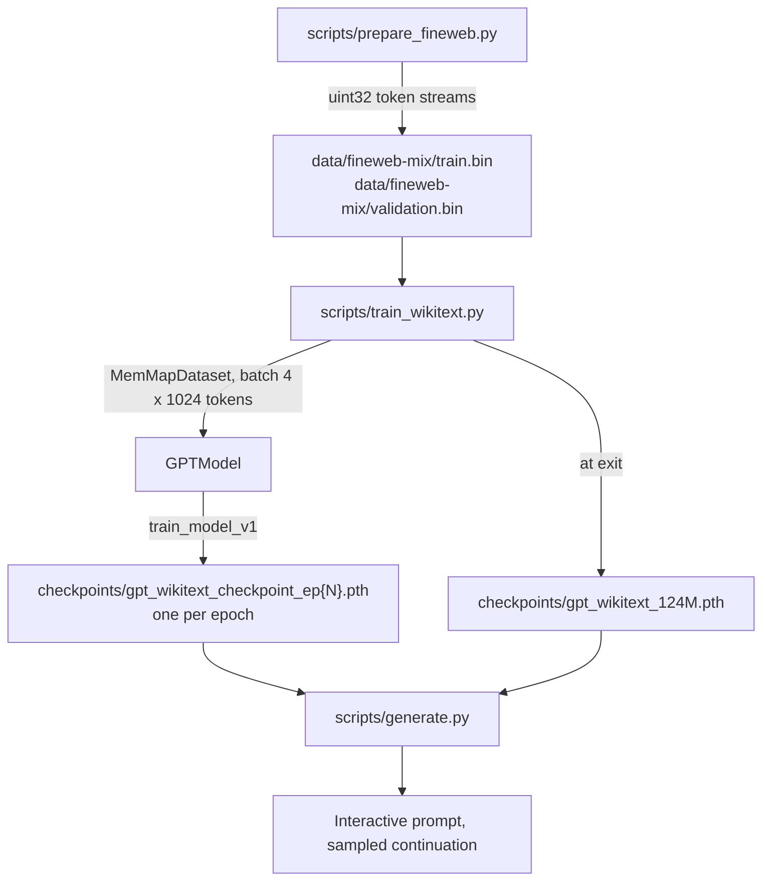

# mini-llm: codebase documentation

A GPT-style, decoder-only language model written from scratch in PyTorch. The repository has three parts:

- **The library** (`src/mini_llm/`): the model, the dataloaders, the training loop and text generation. It is an installable package and holds everything that gets imported.
- **The scripts** (`scripts/`, plus `train_colab.ipynb` at the root): the entry points that prepare WikiText-103, train on it, and sample from the result.
- **The study scripts** (`study/p01_*` to `study/p04_*`): four stages that build the ideas up one at a time, from a regex tokenizer to a transformer block. They print their results and nothing in the library imports them.

## Snapshot

These docs were written on 2026-10-10 against commit `0bb727c` and updated on 2026-10-11 for the causal-mask fix, for the reorganization into `src/mini_llm/`, `scripts/` and `study/`, for the fixes to known issues 2 and 11, for the rolling checkpoint, for the FineWeb training data, and for the training recipe: a tied output head, small initial weights, dropout 0, PyTorch's own attention and normalization functions, gradient accumulation and a learning-rate schedule. Paths and line numbers refer to the layout after the reorganization.

Where a page says **verified**, the behaviour was checked by running the code with Python 3.10.20, torch 2.2.2, tiktoken 0.14.0 and numpy 1.26.4, on CPU unless the page says otherwise.

What was run, and how:

- **`train_tiny.py`, `train_wikitext.py`, `generate.py`**: end to end, on CPU and on MPS, with the model config shrunk to one 8-dimensional layer so a run takes seconds. For `train_wikitext.py` the DataLoader workers were also switched off, because the script cannot start them on macOS (see [08-known-issues.md](08-known-issues.md)).
- **`train_wikitext.py` with a compiled model**: on CPU with the shrunken config and `torch.compile`'s `eager` backend, as five runs sharing one checkpoint folder: one killed inside an epoch, one interrupted, one killed in the middle of a save, one run to the end, and one that found nothing left to do.
- **`generate.py` at full size**: on MPS, from a 1.95 GB checkpoint with random weights.
- **`train_tiny.py` at full size**: on MPS, with the checkpoint writes switched off, since it would write 19.5 GB.
- **`prepare_wikitext.py`**: with the download replaced by a few lines of text, and once with the real download.
- **`prepare_fineweb.py`**: for real, at its default size of 1 billion tokens.

On 2026-10-11 the notebook trained the model as it then was, with a 256-token context, on a Colab T4 for 16,511 steps; see [05-training.md](05-training.md#the-colab-run-of-2026-10-11). The model and the training settings as they are now have **not been run** on CUDA or at full size beyond single steps. Statements about that come from reading the code.

## Two things to know before reading the rest

1. **The model has 162,885,120 parameters, not 124M.** The config keeps the name `GPT_CONFIG_124M`, but the vocabulary is twice GPT-2's. Verified. See [04-model.md](04-model.md#parameter-budget).
2. **Run things from the repo root.** Imports work from anywhere once the package is installed, but paths such as `data/basic-data.txt`, `data/wikitext-103/` and `checkpoints/` are relative to the working directory. See [07-running.md](07-running.md).

## Pages

| Page | Covers |
|---|---|
| [01-tokenization.md](01-tokenization.md) | Regex tokenizer, `SimpleTokenizer` / `SimpleTokenizerV2`, the `cl100k_base` BPE tokenizer |
| [02-data-pipeline.md](02-data-pipeline.md) | Sliding-window datasets, embedding demos, WikiText-103 preparation, the memory-mapped dataset |
| [03-attention.md](03-attention.md) | The attention progression from dot products to `MultiHeadedAttention` |
| [04-model.md](04-model.md) | `LayerNorm`, `GELU`, `FeedForward`, `TransformerBlock`, `GPTModel`, the config, the parameter budget |
| [05-training.md](05-training.md) | Loss, evaluation, the training loop, `train_tiny.py`, `train_wikitext.py`, checkpoints, the Colab notebook |
| [06-inference.md](06-inference.md) | Greedy and sampled generation, the interactive CLI |
| [07-running.md](07-running.md) | Setup, the command for every script, devices, tests, and what each script writes to disk |
| [08-known-issues.md](08-known-issues.md) | Defects, gaps and duplicated code, each with its location and how it was checked |

## End-to-end flow



`train_tiny.py` is a smaller version of the same loop: it trains the same model on `data/basic-data.txt` using the in-memory `CustomDataset`. `prepare_wikitext.py` writes the same kind of files from the much smaller WikiText-103. `train_colab.ipynb` runs the first two scripts on a Colab GPU, with `checkpoints/` replaced by a folder on Google Drive.

## Repository map

```text
mini-llm/
├── README.md                  project overview and quick start
├── pyproject.toml             dependencies; makes mini_llm installable
├── uv.lock                    resolved dependency versions, for uv
├── .python-version            3.10, the interpreter uv uses here
├── train_colab.ipynb          runs preparation and training on Colab
├── src/
│   └── mini_llm/              the library
│       ├── config.py          GPT_CONFIG_124M, the one model config
│       ├── device.py          get_device(): cuda, then mps, then cpu
│       ├── corpus.py          turns streams of documents into token files
│       ├── data.py            in-memory and memory-mapped datasets
│       ├── generation.py      greedy and sampled generation, token helpers
│       ├── model/
│       │   ├── attention.py   MultiHeadedAttention
│       │   ├── layers.py      LayerNorm, GELU, FeedForward
│       │   ├── block.py       TransformerBlock
│       │   └── gpt.py         GPTModel
│       └── training/
│           ├── loss.py        cross-entropy over a batch or a loader
│           ├── evaluate.py    train and validation loss
│           ├── checkpoint.py  checkpoint files: rolling saves, resume, pruning
│           ├── schedule.py    the learning rate for each weight update
│           ├── optimizer.py   AdamW, with weight decay on the matrices only
│           └── trainer.py     the training loop
├── scripts/
│   ├── prepare_fineweb.py     download + tokenize the FineWeb mix into .bin files
│   ├── prepare_wikitext.py    the same for the much smaller WikiText-103
│   ├── train_wikitext.py      main training script (GPU, resume, torch.compile)
│   ├── train_tiny.py          smoke test + 10-epoch training on basic-data.txt
│   └── generate.py            load weights, interactive generation
├── study/
│   ├── p01_tokenization/      stage 1: tokenizers
│   ├── p02_data_loading/      stage 2: sliding windows and embeddings
│   ├── p03_attention/         stage 3: attention variants
│   └── p04_gpt/               stage 4: the sandbox script
├── tests/
│   ├── test_causal_mask.py    a position must not see later tokens
│   ├── test_checkpoint.py     a stopped run resumes and ends with the same weights
│   ├── test_corpus.py         the prepared token files hold what they should
│   ├── test_generation.py     sampled ids without a token still decode
│   ├── test_model.py          the layers match their formulas; the output head is tied
│   ├── test_optimizer.py      which parameters are decayed, and the betas
│   └── test_schedule.py       the learning rate rises, then falls along a cosine
├── data/
│   └── basic-data.txt         20,480-character short story used by the study scripts
└── docs/                      this folder
```

Two folders appear when the scripts run and are ignored by git: `data/wikitext-103/` and `checkpoints/`.

## File reference

### Library

Paths are relative to `src/mini_llm/`. Imports are absolute, for example `from mini_llm.training.loss import calc_loss_batch`.

| File | Defines | Imported by |
|---|---|---|
| `config.py` | `GPT_CONFIG_124M` | `train_tiny.py`, `train_wikitext.py`, `generate.py` |
| `device.py` | `get_device` | the same three scripts |
| `model/gpt.py` | `GPTModel` | the same three scripts, the tests |
| `model/block.py` | `TransformerBlock` | `model/gpt.py`, `study/p04_gpt/architecture.py` |
| `model/attention.py` | `MultiHeadedAttention` | `model/block.py`, the tests |
| `model/layers.py` | `LayerNorm`, `GELU`, `FeedForward` | `model/gpt.py`, `model/block.py`, `study/p04_gpt/architecture.py` |
| `corpus.py` | `prepare_corpus`, `write_manifest`, `read_manifest`, and the helpers `take_from_file`, `encode_documents`, `encode_batch` | `prepare_fineweb.py` |
| `data.py` | `CustomDataset`, `create_dataloader`, `MemMapDataset`, `ResumableSampler`, `create_memmap_dataloader` | `training/trainer.py`, `train_tiny.py`, `train_wikitext.py` |
| `training/loss.py` | `calc_loss_batch`, `calc_loss_loader` | `training/trainer.py`, `training/evaluate.py`, `train_tiny.py` |
| `training/evaluate.py` | `evaluate_model` | `training/trainer.py` |
| `training/checkpoint.py` | `load_latest_checkpoint`, `resume_candidates`, `training_progress`, `checkpoint_state`, `rolling_write_order`, `save_rolling_checkpoint`, `prune_epoch_checkpoints`, and the helpers that build the file paths | `training/trainer.py`, `train_wikitext.py`, `generate.py` |
| `training/schedule.py` | `learning_rate_at` | `train_wikitext.py` |
| `training/optimizer.py` | `create_optimizer` | `train_wikitext.py`, the tests |
| `training/trainer.py` | `train_model_v1` | `train_tiny.py`, `train_wikitext.py` |
| `generation.py` | `textgen_v1`, `textgen_v2`, `text_to_token_ids`, `decode_token_ids`, `token_ids_to_text`, `generate_and_print_sample` | `training/trainer.py`, `train_tiny.py`, `generate.py` |

`train_wikitext.py` also imports `textgen_v1`, `text_to_token_ids`, `token_ids_to_text` and `calc_loss_loader` and never calls them.

### Entry points

| File | What it does | Page |
|---|---|---|
| `scripts/prepare_fineweb.py` | Tokenizes a mix of FineWeb-Edu and FineWeb into `data/fineweb-mix/{train,validation}.bin` | [02](02-data-pipeline.md#preparing-the-fineweb-mix) |
| `scripts/prepare_wikitext.py` | Tokenizes WikiText-103 into `data/wikitext-103/{train,validation}.bin` | [02](02-data-pipeline.md#preparing-wikitext-103) |
| `scripts/train_wikitext.py` | Trains on those files, with resume and checkpoints | [05](05-training.md#train_wikitextpy) |
| `scripts/train_tiny.py` | Counts parameters, generates from the untrained model, trains on `basic-data.txt` | [05](05-training.md#train_tinypy) |
| `scripts/generate.py` | Loads weights and runs a prompt loop | [06](06-inference.md#generatepy) |
| `train_colab.ipynb` | Clones the repo on Colab, prepares the data, starts training in the background and plots its log | [05](05-training.md#colab-notebook) |

### Study scripts

Standalone demos. The library does not import any of them.

| File | Demonstrates | Page |
|---|---|---|
| `study/p01_tokenization/simple_tokenizer.py` | Regex tokenizer with function-style encode/decode | [01](01-tokenization.md) |
| `study/p01_tokenization/encoder_decoder.py` | `SimpleTokenizer`, `SimpleTokenizerV2` | [01](01-tokenization.md) |
| `study/p01_tokenization/test_simple_tokenizer.py` | Drives the two classes above | [01](01-tokenization.md) |
| `study/p01_tokenization/test_byte_pair_encoding.py` | BPE with tiktoken, context/target pairs | [01](01-tokenization.md) |
| `study/p02_data_loading/dataloader.py` | First version of `CustomDataset` / `create_dataloader` | [02](02-data-pipeline.md) |
| `study/p02_data_loading/embedding.py` | `nn.Embedding` as a lookup table | [02](02-data-pipeline.md) |
| `study/p02_data_loading/embed_dataloader.py` | Embedding a batch from the dataloader | [02](02-data-pipeline.md) |
| `study/p03_attention/simple_attention.py` | Attention without trainable weights | [03](03-attention.md) |
| `study/p03_attention/self_attention.py` | Scaled dot-product attention step by step, plus all four attention classes | [03](03-attention.md) |
| `study/p04_gpt/architecture.py` | `DummyGPT`, layer-norm and shortcut-gradient experiments | [04](04-model.md#the-sandbox-studyp04_gptarchitecturepy) |

### Tests

| File | Checks |
|---|---|
| `tests/test_causal_mask.py` | Changing one token, or one input vector, leaves every earlier output of `GPTModel` and `MultiHeadedAttention` unchanged. Both tests fail if the mask stops being applied (verified). |
| `tests/test_checkpoint.py` | The sampler's order depends only on seed and epoch and can be continued from a position. The rolling files are written in turn and never start with the file resumed from. Resume takes the newest file it can read and refuses to start over when none can be read. Pruning keeps the newest epoch checkpoints by number. A run interrupted, or stopped by an error, inside an epoch or at the end of one ends after its resume with weights bit-identical to an uninterrupted run. Gradients accumulated over several batches give the update one large batch gives, a run stopped between two updates resumes at the last one, and the schedule's rate is the one each update uses. |
| `tests/test_corpus.py` | Every document ends with the end-of-text token and decodes back; that token written inside a page stays ordinary text; each source gets its share, spread over all of its files; validation documents come from every file, are shuffled and are never trained on; a document that appears twice is used once; two runs write identical files; the manifest marks only a finished run. Each property was checked by breaking it (verified). |
| `tests/test_model.py` | The output head and the token embedding are one matrix, also after weights are loaded. A new model scores close to a uniform guess. `LayerNorm`, `GELU` and `MultiHeadedAttention` give what the formulas written out by hand give, and attention dropout is applied in training only. Each fails when the code is changed to break it (verified). |
| `tests/test_schedule.py` | The learning rate rises in equal steps to the peak, falls along a cosine to the final value and stays there. |
| `tests/test_generation.py` | `decode_token_ids` returns what `tokenizer.decode` returns when every id has a token, writes an id without a token as its number, and lets the trainer's end-of-epoch sample print when the model emits such an id. The last two fail if the old decode is put back (verified). |

### Other

| Path | Notes |
|---|---|
| `pyproject.toml` | Dependencies, the `data` extra for the prepare scripts, the `dev` group with pytest, and the Intel-Mac pins. See [07-running.md](07-running.md#setup). |
| `data/basic-data.txt` | 20,480 characters, 164 lines, plain ASCII. The file has no title; the text is recognizable as Edith Wharton's short story "The Verdict". |
| `.gitignore` | Ignores virtualenvs, bytecode, `.gemini/`, `GEMINI.md`, `graphify-out/`, editor folders, `.DS_Store`, `token.txt`, and the generated `checkpoints/`, `*.pth` and `data/wikitext-103/`. |

## Conventions used in the code

- **Config** is a plain dict with long key names: `vocab_size`, `context_length`, `embedding_dimension`, `n_heads`, `n_layers`, `drop_rate`, `qkv_bias`. Modules take the whole dict.
- **Tokenizer** is `tiktoken.get_encoding("cl100k_base")` everywhere outside stage 1.
- **Versioned names**: `_v1` / `_v2` mark successive versions of the same idea (`SelfAttention_v1`, `textgen_v2`, `train_model_v1`). Earlier versions are kept in the study scripts.
- **Scripts run at import time.** Most study scripts and `train_tiny.py` / `train_wikitext.py` have no `main()` guard, so importing them executes them.
- **The files named `test_*.py` under `study/` are scripts.** The real tests are in `tests/`, and pytest is configured to collect only from there.

## Shape notation used in these pages

| Symbol | Meaning | Value in `GPT_CONFIG_124M` |
|---|---|---|
| `B` | batch size | 2 in `train_tiny.py`, 4 in `train_wikitext.py` |
| `T` | tokens in the sequence | up to 1,024; 256 in `train_tiny.py` |
| `D` | `embedding_dimension` | 768 |
| `H` | `n_heads` | 12 |
| `V` | `vocab_size` | 100,352 |

## What is not implemented

Stated so nobody goes looking: weight tying, a learning-rate schedule or warmup, gradient accumulation, a key/value cache for generation, loading pretrained GPT-2 weights, fine-tuning, and loss logging inside the trainer (the loss lists are returned and dropped; the notebook plots from the printed log lines).

## A note on origin

The stage layout and many names (`SelfAttention_v1`, `MultiHeadAttentionWrapper`, `DummyGPT`, `ExampleDeepNeuralNetwork`, `GPT_CONFIG_124M`, the prompt "Every effort moves you") match Sebastian Raschka's book *Build a Large Language Model (From Scratch)*. The repository does not say this itself; it is an inference from the code. It explains the "124M" name, which is GPT-2 small's parameter count with a 50,257-token vocabulary and a tied output head.
